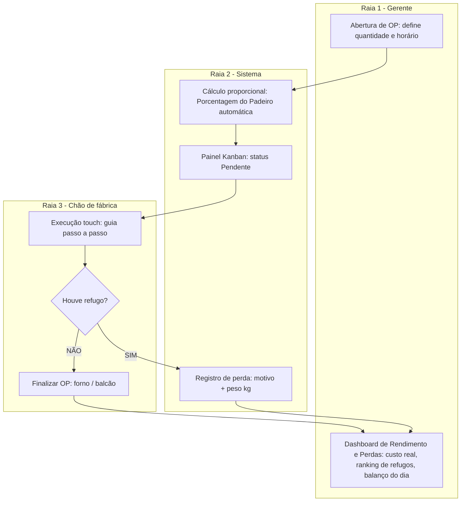
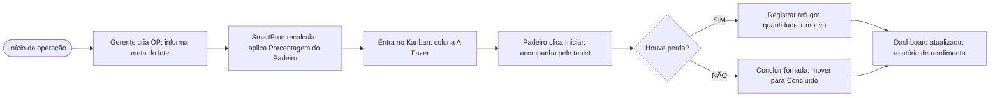

# 03 — Pré-Projeto UC HUB

> Fonte: *Pré-Projeto — app_sistemas — UC HUB*. Dados pessoais da equipe (nomes completos, matrículas, e-mails institucionais) ficam no PDF original e **não** são versionados aqui; o repositório é público.

## 1. Equipe e parceria

- **Equipe:** Ana, Breno, Giovanne, Igor, Ledson, Marcelo (cursos: Sistemas de Informação, Análise e Desenvolvimento de Sistemas, Ciência da Computação).
- **Parceria:** o campo ficou em branco no PDF (sem parceria informada).

## 2. Concorrentes e similares

| App | Site | Forças | Fraquezas | Onde o SmartProd ganha | Onde o SmartProd perde |
|---|---|---|---|---|---|
| Nex | programanex.com.br | Caixa, vendas de balcão (PDV), cadastro básico de clientes, estoque geral de mercadorias revendidas | Sem fichas técnicas, não calcula Porcentagem do Padeiro, não controla o passo a passo | Foco na cozinha/chão de fábrica, perdas por etapa, fichas técnicas de panificação | Frente de caixa (PDV), notas fiscais, fiado/clientes |
| vhsys | vhsys.com.br | Vendas, PDV, estoque, financeiro completo, notas fiscais | Foco administrativo/financeiro; sem Kanban visual em tempo real para a cozinha | Foco exclusivo no operador, esteira visual e cálculo automático por porcentagem | Notas fiscais e integração bancária completa |
| Conta Azul | contaazul.com | Gestão financeira, fluxo de caixa, boletos, conciliação bancária, relatórios | Só contabilidade/finanças; ignora o processo produtivo artesanal, perdas e rendimento de fornadas | Engenharia de cardápio, cálculo por demanda/estoque, alerta de desperdício | Conciliação bancária, cartões, contabilidade fiscal |

## 3. Envolvidos / usuários

Gerente/Proprietário, Padeiro/Confeiteiro e Ajudante de Cozinha (ver [02-requisitos.md](02-requisitos.md)).

## 4. Fluxo da atividade (raias)

## 5. Como o produto atua (3 pilares)

1. **Padronização de receitas:** calcula ingredientes pela Porcentagem do Padeiro, recalcula por lote e elimina erros de dosagem.
2. **Guia operacional na cozinha:** passo a passo em telas touchscreen, com temporizadores de fermentação/forno e registro simples de perdas na esteira (Kanban).
3. **Visibilidade gerencial:** dados em tempo real sobre rendimento das fornadas e custo financeiro do desperdício acumulado.

**Contribuição pretendida:** transformar a produção artesanal numa esteira padronizada e sem desperdícios, com qualidade constante e margem de lucro protegida.

## 6. Sequência de uso

## 7. Telas previstas (mockups no PDF)

1. **Login** — título "Acesse sua padaria", campos e-mail e senha, seletor de função (Gerente/Padeiro), "manter-me conectado". O mockup também mostra botões de login social (Google/Facebook) — **fora do escopo** (ver Q6).
2. **Dashboard do gerente** — menu lateral (Dashboard, Ordens de Produção, Insumos, Relatórios, Configurações), indicadores de produção (kg, custo, perdas), "Fila de Produção Rápida" e "Top 3 Mais Desperdiçados".
3. **Quadro Kanban de Produção / Modo Padeiro** — colunas por etapa do processo (o mockup sugere pesagem, mistura, fermentação, forno e concluído) com cartões de lote e resumo da produção (ver Q5).
4. **Execução passo a passo** — lista de ingredientes com pesagem, passos com temporizadores e botão "Registrar perda".

## 8. Inconsistências de nomenclatura

O fluxo cita a coluna inicial como **"Pendente"** (raias) e **"A Fazer"** (sequência de uso). Padronizar — ver [08-questoes-em-aberto.md](08-questoes-em-aberto.md).
