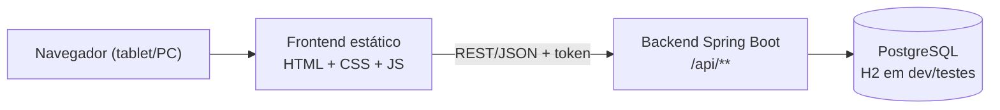

# 06 — Arquitetura

> Decisão-base: [ADR-0001 — Backend em Java/Spring Boot](decisoes/0001-backend-java-spring-boot.md).

## 1. Visão geral



- Frontend e backend são **aplicações separadas**, comunicando por REST/JSON. O backend não serve HTML.
- O frontend roda sem build (arquivos estáticos); pode ser hospedado em Vercel/Render Static.

## 2. Stack e versões

| Item | Versão / escolha | Observação |
|---|---|---|
| Java | 21 (LTS) | Exigido pelo `pom.xml` |
| Spring Boot | 3.5.16 | Última linha 3.x; ver nota abaixo |
| Build | Maven via wrapper (`mvnw`) | Ninguém precisa instalar Maven |
| Persistência | Spring Data JPA + Hibernate, `ddl-auto=validate` | Esquema controlado só pelo Flyway |
| Migrações | Flyway | `backend/src/main/resources/db/migration` |
| Banco | PostgreSQL (prod) / H2 modo PostgreSQL (dev e testes) | |
| Segurança | Spring Security (stateless) + BCrypt(12) | Autenticação com token a implementar no RF001 |
| Documentação da API | springdoc-openapi (`/swagger-ui.html`) | Desligada no perfil `prod` |
| Observabilidade | Actuator (`/actuator/health`) | Usado como health check na hospedagem |
| Testes | JUnit 5, AssertJ, Mockito, MockMvc, `@DataJpaTest` | |

> **Nota sobre versões:** o Spring Boot 4.x já existe, mas a 3.5.x foi mantida por ter muito mais material, exemplos e conhecimento de IAs (nomes de starters e pacotes de teste mudaram na 4.x). Migrar para 4.x é um passo futuro opcional.

## 3. Estrutura do backend

Pacote raiz `br.com.smartprod`, organizado por funcionalidade:

```
br.com.smartprod
├── SmartProdApplication
├── config/            SecurityConfig (filtros, CORS, BCrypt)
├── shared/            utilitários e exceções comuns (a criar)
├── usuario/           Usuario, Perfil, UsuarioRepository   (F1)  ← já existe
├── insumo/            (F2)
├── receita/           ficha técnica, ingredientes, passos, calculadora (F2/F3)
├── producao/          Ordem de Produção, Kanban, execução (F4)
├── perda/             refugos e perdas (F5)
└── dashboard/         indicadores (F6)
```

Dentro de cada pacote: `XController` (REST) → `XService` (regras) → `XRepository` (JPA) + entidade + `dto/` (records). Controllers não acessam repositórios diretamente.

## 4. Convenções de API

- Prefixo `/api`; recursos em português no plural: `/api/insumos`, `/api/fichas-tecnicas`, `/api/ordens-producao`, `/api/perdas`, `/api/dashboard`, `/api/auth/login`.
- Verbos: `GET` lê, `POST` cria, `PUT` substitui, `PATCH` altera parcialmente, `DELETE` remove (usuários são **inativados**, não removidos — RF002).
- Erros no formato RFC 7807 (`application/problem+json`); `400` validação, `401` sem login, `403` sem permissão, `404` não encontrado, `409` conflito.
- Entidades JPA **nunca** são devolvidas; use DTOs. Entradas com `@Valid`.
- Todas as respostas de cálculo/Kanban devem caber em ≤ 1,5 s (RNF-D001).

## 5. Segurança

- **Autenticação (RF001):** proposta de token JWT no header `Authorization: Bearer …`, pois frontend e backend ficam em domínios diferentes (evita problemas de cookie entre sites). *A confirmar — ver Q3.*
- **Autorização (RNF-S002):** `GERENTE` e `FUNCIONARIO`. Custos de insumos, perdas em R$ e dashboard só para `GERENTE`, com `@PreAuthorize`. DTOs voltados ao Funcionário **não** incluem campos de custo.
- **Senhas (RNF-S001):** BCrypt com força 12.
- **CORS:** origens liberadas por `app.cors.allowed-origins` (env `CORS_ALLOWED_ORIGINS`).
- **Segredos:** só em variáveis de ambiente; o repositório é público.

## 6. Perfis e configuração

| Perfil | Banco | Uso |
|---|---|---|
| `dev` (padrão) | H2 em memória, modo PostgreSQL | desenvolvimento local e testes |
| `prod` | PostgreSQL via variáveis de ambiente | hospedagem |

Variáveis do perfil `prod`: `DB_URL` (ex.: `jdbc:postgresql://host:5432/smartprod`), `DB_USERNAME`, `DB_PASSWORD`, `CORS_ALLOWED_ORIGINS`, `PORT` (a hospedagem costuma definir).

Para testar contra um PostgreSQL local sem mudar o código: `SPRING_PROFILES_ACTIVE=prod` mais as variáveis acima.

## 7. Frontend

HTML5 + CSS3 + JavaScript puro em `frontend/`. A URL da API fica em `frontend/js/config.js`. Interface operacional (Funcionário) segue RNF-U001/U002: botões ≥ 48 px, alto contraste, ≤ 3 cliques; progresso da etapa em `localStorage` (RNF-C002).

## 8. Integração contínua e deploy

- **CI:** `.github/workflows/backend-ci.yml` roda `./mvnw verify` (JDK 21) em push/PR que toque `backend/`.
- **Deploy (pendente):** backend Java no Render exige um **Dockerfile** (ainda não criado); frontend em Vercel ou Render Static; banco em Neon/Supabase/Render PostgreSQL. Planos gratuitos podem "dormir" e afetar a meta de 99,5% (RNF-C001) — ver Q4.
