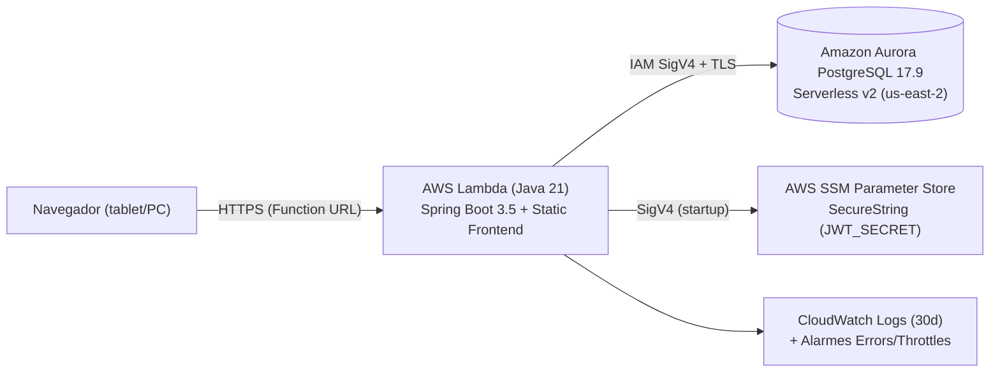

# 06 — Arquitetura

> Decisões arquiteturais: [ADR-0001 — Backend em Java/Spring Boot](decisoes/0001-backend-java-spring-boot.md) · [ADR-0002 — Deploy em AWS Lambda + Aurora PostgreSQL Serverless v2](decisoes/0002-deploy-aws-lambda-aurora.md).

## 1. Visão geral



- **Em desenvolvimento local (`dev`):** frontend estático servido separadamente (`http://localhost:5500`) consumindo a API REST (`http://localhost:8080`) com H2 em memória.
- **Em produção (`prod`, AWS `us-east-2`):** o script `backend/scripts/build-lambda.ps1` empacota o backend Spring Boot (`aws-serverless-java-container-springboot3`) junto com o `frontend/` em `static/` (mesma origem, UTF-8 garantido por `StaticFrontendConfig`) num pacote `.zip` (~36 MB) publicado na função **AWS Lambda**, conectado ao **Amazon Aurora PostgreSQL 17.9 Serverless v2** com autenticação IAM e TLS.

## 2. Stack e versões

| Item | Versão / escolha | Observação |
|---|---|---|
| Java | 21 (LTS) | Exigido pelo `pom.xml` |
| Spring Boot | 3.5.16 | Linha 3.5.x + `aws-serverless-java-container-springboot3` 2.1.7 |
| Build | Maven via wrapper (`mvnw` / `mvnw.cmd`) | Ninguém precisa instalar Maven |
| Persistência | Spring Data JPA + Hibernate, `ddl-auto=validate` | Esquema controlado só pelo Flyway |
| Migrações | Flyway | `backend/src/main/resources/db/migration` |
| Banco | Amazon Aurora PostgreSQL 17.9 (prod) / H2 modo PostgreSQL (dev e testes) | Autenticação IAM SigV4 + TLS (`sslmode=require`) em produção |
| Segurança | Spring Security (stateless) + BCrypt(12) + JWT (HS256) | Rate limit `429`, logout com revogação (`token_versao`), CSP + HSTS, senha ≥ 10 caracteres |
| Segredos (prod) | AWS SSM Parameter Store (`SecureString`) | Carregado na subida via `SsmParameterClient` (SigV4 Java 21); fallback `JWT_SECRET` para `dev`/local |
| Documentação da API | springdoc-openapi (`/swagger-ui.html`) | Desativada em `application-prod.yml`, `@Profile("!prod")`, excluída do pacote Lambda e sem `permitAll()` em `prod` |
| Observabilidade | Actuator (`/actuator/health`) + CloudWatch Logs/Alarms | `diskspace.path=/tmp` na Lambda; retenção 30 dias + alarmes de `Errors` e `Throttles` |
| Testes | JUnit 5, AssertJ, Mockito, MockMvc, `@DataJpaTest`, Playwright | CI no GitHub Actions + suíte de validação AWS em `testes-producao/` |

## 3. Estrutura do backend

Pacote raiz `br.com.smartprod`, organizado por funcionalidade:

```text
br.com.smartprod
├── SmartProdApplication
├── StreamLambdaHandler     Entrypoint AWS Lambda com init lazy e UTF-8 padrão
├── config/                 SecurityConfig (CSP/HSTS/CORS), IamDataSourceConfig, StaticFrontendConfig, OpenApiConfig, RespostasDeSeguranca, DadosDemonstracao
├── shared/                 TratadorDeErros (RFC 7807), exceções, UsuarioAutenticado
├── usuario/                Usuario (com tokenVersao), Perfil, UsuarioRepository   (F1)
├── auth/                   Login, Logout (revogação), LoginRateLimiter (429), TokenService, UsuarioJwtConverter, SsmParameterClient (F1)
├── insumo/                 Cadastro e consulta de insumos com isolamento de custos (F2)
├── receita/                Ficha técnica, Porcentagem do Padeiro, passos, calculadora (F3)
├── dashboard/              Indicadores de rendimento, desperdício, ranking e status (F6)
├── producao/               Ordem de Produção, bloqueio otimista (@Version), Kanban, execução (F4)
└── perda/                  Refugos e perdas operacionais (F5)
```

Cada pacote segue `XController` (REST) → `XService` (regras) → `XRepository` (JPA) + entidade + `dto/` (records). Controllers não acessam repositórios diretamente.

## 4. Convenções de API

- Prefixo `/api`; recursos em português no plural: `/api/insumos`, `/api/fichas-tecnicas`, `/api/ordens-producao`, `/api/perdas`, `/api/dashboard`, `/api/auth/login`, `/api/auth/logout`.
- Verbos: `GET` lê, `POST` cria/executa ação, `PUT` substitui, `PATCH` altera parcialmente, `DELETE` remove (usuários são **inativados**, não removidos — RF002).
- Erros no formato RFC 7807 (`application/problem+json`), com `title` e `detail` em português (`shared/TratadorDeErros`, `config/RespostasDeSeguranca` e `auth/AuthExceptionHandler`): `400`, `401`, `403`, `404`, `409`, `429` (com `Retry-After`) e `500` genérico sem stack trace.
- Entidades JPA **nunca** são devolvidas; use DTOs e `@Valid`.
- Meta de desempenho: cálculo proporcional e recarga do Kanban em ≤ 1,5 s (**RNF-D001** — validado na AWS em [testes-em-producao.md](testes-em-producao.md)).

## 5. Segurança

- **Autenticação (RF001):** token JWT (HS256) no header `Authorization: Bearer …` emitido em `POST /api/auth/login` (validade padrão de 8 h via `JWT_VALIDADE_MINUTOS`). Usuário, status `ativo`, perfil e `token_versao` são conferidos no banco a cada requisição (`UsuarioJwtConverter`): inativação, troca de perfil ou logout em `POST /api/auth/logout` revogam o acesso imediatamente.
- **Proteção contra força bruta:** `LoginRateLimiter` bloqueia excesso de falhas no login retornando `429 Too Many Requests` com cabeçalho `Retry-After` e detalhe em português.
- **Autorização (RNF-S002):** `GERENTE` e `FUNCIONARIO` via `@PreAuthorize`. Custos de insumos, perdas em R$ e dashboard são restritos a `GERENTE`; DTOs do Funcionário não carregam campos financeiros.
- **Cabeçalhos HTTP:** `Content-Security-Policy` restritiva (`script-src 'self'`, `object-src 'none'`, `frame-ancestors 'none'`), `Strict-Transport-Security` (`max-age=31536000; includeSubDomains`), `X-Frame-Options: DENY`, `X-Content-Type-Options: nosniff` e `Referrer-Policy: strict-origin-when-cross-origin`.
- **Senhas (RNF-S001):** BCrypt força 12, mínimo de 10 e máximo de 72 caracteres.
- **CORS:** origens permitidas via `CORS_ALLOWED_ORIGINS` (em produção, apenas a URL oficial da aplicação; `localhost` somente em `dev`).
- **Infraestrutura AWS (`us-east-2`):** execução da Lambda com role IAM de menor privilégio (somente logs do próprio log group, `rds-db:connect` no cluster `database-1` e leitura/decriptação do parâmetro `SecureString` no SSM Parameter Store); Aurora com `DeletionProtection` ativada.

## 6. Perfis e configuração

| Perfil | Banco | Uso |
|---|---|---|
| `dev` (padrão) | H2 em memória, modo PostgreSQL | Desenvolvimento local e testes automatizados |
| `prod` | Amazon Aurora PostgreSQL (ou PostgreSQL local via env vars) | Produção na AWS |
| `demo` (junto com `dev`) | H2 em memória | Demonstração com dados pré-carregados (`config/DadosDemonstracao`) — não usar com dados reais |

Variáveis do perfil `prod`:

| Variável | Obrigatória | Para quê |
|---|---|---|
| `SPRING_PROFILES_ACTIVE=prod` | sim | Ativa o perfil de produção (desativa H2, Swagger e defaults de dev) |
| `DB_URL`, `DB_USERNAME` | sim | Conexão PostgreSQL / Aurora (`jdbc:postgresql://host:5432/postgres`) |
| `DB_IAM_AUTH`, `DB_IAM_REGION` | na AWS | `true` + `us-east-2` para autenticar no Aurora via SigV4 + TLS (dispensa `DB_PASSWORD`) |
| `DB_PASSWORD` | se `DB_IAM_AUTH=false` | Senha do PostgreSQL quando não usa IAM Auth |
| `JWT_SECRET_SSM_PARAM` | recomendado na AWS | Nome do parâmetro `SecureString` no SSM Parameter Store (ex.: `/smartprod/prod/jwt-secret`) |
| `JWT_SECRET` | fallback (sem SSM) | Segredo HS256 (≥ 32 caracteres) quando executado fora da AWS |
| `CORS_ALLOWED_ORIGINS` | sim | Origem oficial do frontend publicado |
| `JWT_VALIDADE_MINUTOS` | não | Validade do token em minutos (padrão `480`) |
| `SEED_GERENTE_EMAIL`, `SEED_GERENTE_SENHA` | apenas no 1º bootstrap | Cria o primeiro gerente em banco vazio; **remover após criar o gerente nominal** |

## 7. Frontend

HTML5 + CSS3 + JavaScript puro (ES modules, sem build) em `frontend/`. Cada tela fica em `frontend/pages/<tela>/` com `index.html`, `main.js` e CSS próprio; a base comum fica em `frontend/js/core/` (`config.js`, `api.js`, `auth.js`, `menu.js`, `formato.js`, `dom.js`, `cadastro.js`, `tutorial.js`) e `frontend/css/base.css`. O token fica em `sessionStorage` e o botão **Sair** chama `POST /api/auth/logout` antes de limpar a sessão local. A interface do Funcionário segue RNF-U001/U002 (botões ≥ 48 px, alto contraste, ≤ 3 cliques) e RNF-C002 (progresso da etapa salvo em `localStorage`).

## 8. Integração contínua e deploy

- **CI:** `.github/workflows/backend-ci.yml` executa `./mvnw -B verify` (JDK 21) e `.github/workflows/frontend-ci.yml` valida sintaxe ES modules de todos os arquivos `.js` do frontend.
- **Empacotamento e deploy na AWS (`us-east-2`):** `backend/scripts/build-lambda.ps1` compila o backend, embute `frontend/` em `static/` (ajustando `apiUrl: ""` e timeout de `45 s`) e gera `backend/target/smartprod-lambda.zip` (~36 MB, abaixo do limite de 50 MB para upload direto na Lambda).
- **Medições reais de produção:** ver [testes-em-producao.md](testes-em-producao.md) e [ADR-0002](decisoes/0002-deploy-aws-lambda-aurora.md).
