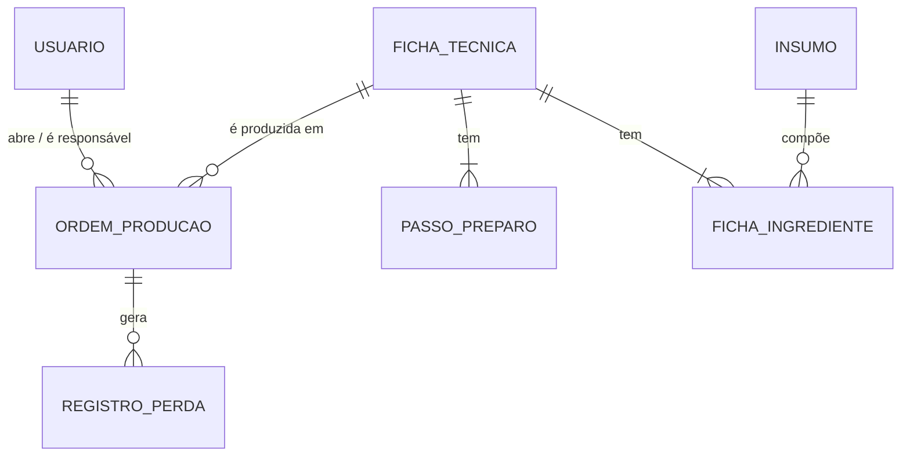
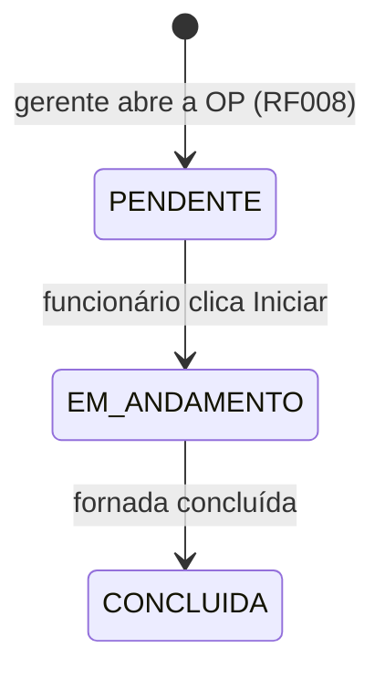

# 07 — Modelo de domínio e regras de negócio

> Derivado de `02-requisitos.md` e do Pré-Projeto. As entidades marcadas com ✅ já existem no código. Itens marcados *(?)* dependem de resposta em [08-questoes-em-aberto.md](08-questoes-em-aberto.md).

## 1. Entidades



| Entidade | Campos principais | Requisitos |
|---|---|---|
| `Usuario` ✅ | nome, email (único, minúsculo), senhaHash, perfil (`GERENTE`/`FUNCIONARIO`), ativo, criadoEm | RF001, RF002 |
| `Insumo` ✅ | nome, unidadeMedida (`G`, `KG`, `ML`, `L`, `UN`), custoUnitario (R$ por unidade de medida, até 4 casas), ativo | RF004 |
| `FichaTecnica` ✅ | nome, rendimentoPadrao (unidades por receita base) | RF005 |
| `FichaIngrediente` ✅ | fichaTecnica, insumo, quantidadeBase (na unidade do insumo), ehFarinha | RF005, RF006 |
| `PassoPreparo` ✅ | fichaTecnica, ordem, etapa, descrição, duracaoSegundos (opcional → temporizador) | RF005, RF010 |
| `OrdemProducao` ✅ | fichaTecnica, quantidadeUnidades, horarioEntrega, responsável (qualquer usuário ativo), criadoPor (Gerente), status, iniciadaEm, concluidaEm, quantidadeProduzida, versao (concorrência) | RF008, RF009, RF015 |
| `RegistroPerda` ✅ | ordemProducao, etapa, pesoKg, unidades (opcional), motivo, registradoPor, registradoEm | RF011, RF013, RF014 |

## 2. Fórmulas

**Porcentagem do Padeiro (RF006).** A soma das quantidades dos ingredientes marcados como farinha vale 100%.

```
pct_i = quantidade_i / soma(quantidade das farinhas) × 100
```

Exemplo: farinha 1000 g, água 700 g, sal 20 g, fermento 10 g → 100%, 70%, 2%, 1%.

**Recálculo por demanda (RF007).**

```
fator          = unidades_desejadas / rendimentoPadrao
quantidade_i'  = quantidade_i × fator
```

**Recálculo por estoque disponível (RF007).**

```
fator_i        = estoque_i / quantidade_i            (para cada ingrediente)
fator          = menor fator_i                        (o ingrediente limitante)
unidades       = floor(fator × rendimentoPadrao)
```

O resultado deve informar também **qual ingrediente limita** a produção. *(? Q2: de onde vem o estoque.)*

**Custo.**

```
custo_receita  = soma(quantidade_i × insumo_i.custoUnitario)   (a quantidade já está na unidade do insumo)
custo_unidade  = custo_receita / rendimentoPadrao
peso_massa_kg  = soma(quantidade_i em kg)                      (g e ml ÷ 1000, kg e L direto, 1 ml = 1 g; UN fica de fora)
custo_por_kg   = custo_receita / peso_massa_kg                 (sem ingrediente pesável, não há custo por kg)
custo_perda    = pesoKg da perda × custo_por_kg da ficha da OP (decisão de 2026-11-18)
```

**Dashboard.**

```
rendimento_diario_% = produzido_no_dia / previsto_no_dia × 100     (OPs com entrega no dia; produzido = soma das concluídas)
desperdicio_periodo = soma(RegistroPerda.pesoKg) e soma(custo_perda) no período
ranking             = 3 produtos com mais kg perdidos no período
status_ops          = pendentes e em andamento (todas) + concluídas hoje
```

## 3. Ciclo de vida da OP



Regras: só o Gerente abre OP; Gerente e Funcionário iniciam e concluem; a quantidade produzida é obrigatória ao concluir (Q13); perdas só podem ser registradas em OP `EM_ANDAMENTO`; OP concluída fica imutável; se duas pessoas alteram a mesma OP ao mesmo tempo, a segunda recebe 409 (`@Version`). O Kanban agrupa por status (RF009) e, sem filtros, mostra as pendentes, as em andamento e as concluídas hoje — ver Q5 sobre colunas por etapa. Os dias (filtros e dashboard) são do fuso `America/Sao_Paulo`.

## 4. Regras de acesso

| Recurso | GERENTE | FUNCIONARIO |
|---|---|---|
| Usuários | CRUD/inativar | — |
| Insumos (com custo) | CRUD | só leitura **sem custo** |
| Fichas técnicas | CRUD | leitura (ingredientes e passos, sem custo) |
| Abrir OP | sim | não |
| Kanban / executar OP | ver tudo | ver/iniciar/concluir |
| Registrar perda | sim | sim |
| Dashboard e relatórios (R$) | sim | **não** (RNF-S002) |
